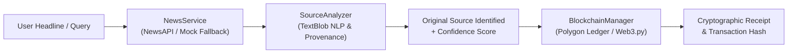

# Blockchain News Source Tracer & Provenance Verifier 📰🔗

An automated news verification and provenance tracking pipeline that traces viral headlines back to their primary origin using Natural Language Processing (NLP), evaluates journalistic credibility, and anchors cryptographic verification receipts to an immutable decentralized ledger (**Polygon/Ethereum**).

---

## 🌟 Key Features

- **Automated Headline & Topic Tracing:** Queries live global news feeds via NewsAPI (with automated mock fallback for offline or zero-key execution).
- **NLP Source & Provenance Analysis:** Evaluates article publication timestamps, publisher reputational weight, and lexical sentiment using `TextBlob`.
- **Credibility Confidence Scoring:** Computes an objective score (0–100) determining the likelihood that a given article is the original source.
- **Decentralized Ledger Anchoring:** Generates SHA-256 digital fingerprint receipts and submits them to the Polygon blockchain (with seamless simulated transaction fallback).
- **Zero-Dependency Quick Testing:** Works instantly out of the box with built-in simulations if API keys are not provided.

---

## 🏗 Architecture & Flow



```
finalproject/
├── src/
│   ├── news_service.py     # Live NewsAPI & simulated data fetcher
│   ├── analyzer.py         # TextBlob NLP analysis & source ranking
│   └── blockchain.py       # Web3 Polygon ledger integration & fallback
├── main.py                 # CLI entrypoint
├── requirements.txt        # Python dependencies
└── .env.example            # Environment template
```

- **Language:** Python 3.9+
- **NLP & Analysis:** TextBlob, Python Requests
- **Blockchain:** Web3.py (Polygon Mainnet/Mumbai testnet ready)
- **Configuration:** Python-Dotenv

---

## 🚀 Quick Start

### 1. Prerequisites
- Python 3.9+

---

### 2. Installation
```bash
# Clone the repository
git clone https://github.com/Chiru9030/blockchain-news-source-tracer.git
cd blockchain-news-source-tracer

# Create and activate virtual environment
python3 -m venv venv
source venv/bin/activate

# Install dependencies
pip install -r requirements.txt
```

---

### 3. Configuration (Optional)
```bash
cp .env.example .env
```
*Note: If no `.env` or keys are provided, the system automatically runs in high-fidelity simulation mode.*

---

### 4. Running the Tracer

Trace any headline or query:
```bash
python3 main.py "Breakthrough in renewable solar cells"
```

**Example Output:**
```
🔍 Tracing source for: 'Breakthrough in renewable solar cells'...

✅ Found 2 related articles.

------------------------------------------------
🏆 IDENTIFIED ORIGINAL SOURCE
------------------------------------------------
Source: Mock Source 2 - The Original
Title:  AI Solves Everything
Date:   2023-10-26T09:00:00Z
URL:    http://mock2.com
Confidence Score: 60/100
------------------------------------------------

🔗 Recording to Decentralized Ledger (Polygon)...
Warning: No Blockchain connection (RPC URL missing). Using simulation.
✅ Verified & Recorded!
Transaction Hash: 0xb943226501bdeb43bf6de662786481a043d678dee9d0797ede38618c3328... (SIMULATED)
```

---

## 📄 License
Licensed under the [MIT License](LICENSE).
